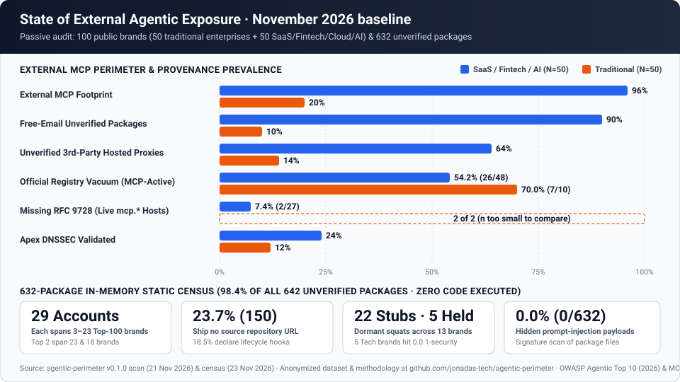

# `agent-perimeter`

**Passive External Attack Surface Management (EASM) CLI for MCP supply-chain provenance, external agent discovery, and OAuth/DNS hygiene.**

[](https://github.com/jonadas-tech/agent-perimeter/actions/workflows/ci.yml)
[](https://github.com/jonadas-tech/agent-perimeter/blob/main/LICENSE)
[](https://github.com/jonadas-tech/agent-perimeter/blob/main/pyproject.toml)

`agent-perimeter` audits what autonomous AI agents and developers encounter *outside* your corporate perimeter when looking up your brand: unverified third-party hosted MCP proxies, unscoped npm/PyPI package collisions, Official MCP Registry gaps, internet-facing `mcp.*` endpoints missing RFC 9728 OAuth metadata, broad OAuth scopes, DNSSEC / IETF DNS-AID posture, and active phishing-warning agent lookalikes.

- **100% Passive & Read-Only:** Public APIs, DNS-over-HTTPS, Certificate Transparency, TLS SANs, and standard `/.well-known/*` discovery paths only. Zero port scanning, zero brute-forcing, zero remote `tools/call`, zero execution of untrusted packages.
- **Zero Runtime Dependencies:** Pure Python 3.11+ standard library; runs instantly via `uvx`.
- **Standards-Aligned:** Maps every finding with verifiable raw evidence to **OWASP Top 10 for Agentic Applications (2026 v1.0)** and **OWASP MCP Top 10 (2025 v0.1 Beta)**.

---

## Quickstart

Run directly with [`uvx`](https://docs.astral.sh/uv/) (no global install required):

```bash
# Single-domain audit -> JSON + single-file HTML brief + SARIF 2.1.0 + Protective DNS RPZ / domain feed
uvx --from git+https://github.com/jonadas-tech/agent-perimeter agent-perimeter audit example.com \
  --json report.json \
  --html report.html \
  --sarif report.sarif \
  --rpz policy.rpz \
  --domain-feed feed.json \
  --rpz-mode block

# Include passive in-memory static inspection of up to 10 unverified npm/PyPI tarballs
uvx --from git+https://github.com/jonadas-tech/agent-perimeter agent-perimeter audit example.com \
  --inspect-packages \
  --json report.json

# Continuous monitoring: diff against a saved baseline and exit 2 on new exposures
uvx --from git+https://github.com/jonadas-tech/agent-perimeter agent-perimeter audit example.com \
  --baseline baseline.json \
  --fail-on-new \
  --sarif report.sarif

# Longitudinal cohort trend analysis (supports raw batch JSON or anonymized study JSON)
uvx --from git+https://github.com/jonadas-tech/agent-perimeter agent-perimeter trend \
  cohort_2026_q4.json cohort_2027_q1.json \
  --label-prev 2026-Q4 --label-curr 2027-Q1 \
  --json trend.json --md trend.md
```

Batch-audit a list of domains and emit an anonymized dataset + Markdown summary:

```bash
uvx --from git+https://github.com/jonadas-tech/agent-perimeter agent-perimeter batch datasets/top100_brands.json \
  --output raw_batch.json \
  --anonymized-out study_anonymized.json \
  --study-md study_summary.md \
  --workers 8
```

Optional environment variables:
- `GITHUB_TOKEN` (or authenticated `gh` CLI) for GitHub org domain anchoring (`blog`/`email`) and higher rate limits.
- `CERTSPOTTER_API_KEY` for higher CertSpotter Certificate Transparency throughput (falls back automatically to bounded `crt.sh` + live TLS SAN extraction).

---

## Continuous Monitoring in GitHub Actions (SARIF + Baseline Diff)

Drop a weekly passive check into `.github/workflows/agent-perimeter.yml` to surface new external MCP exposures directly in GitHub Code Scanning:

```yaml
name: External Agentic Perimeter Monitor

on:
  schedule:
    - cron: "0 12 * * 1" # Every Monday at 12:00 UTC
  workflow_dispatch:

permissions:
  security-events: write
  contents: read

jobs:
  audit:
    runs-on: ubuntu-latest
    steps:
      - uses: actions/checkout@v4
      - uses: astral-sh/setup-uv@v5
      - name: Run passive external MCP audit
        env:
          GITHUB_TOKEN: ${{ secrets.GITHUB_TOKEN }}
        run: |
          uvx --python 3.12 --from git+https://github.com/jonadas-tech/agent-perimeter \
            agent-perimeter audit example.com \
            --json latest.json \
            --html latest.html \
            --sarif agent-perimeter.sarif
      - name: Upload SARIF to GitHub Code Scanning
        uses: github/codeql-action/upload-sarif@v3
        with:
          sarif_file: agent-perimeter.sarif
```

---

## What It Audits

| Vector | Focus | Passive Signals Verified | OWASP Mapping |
|---|---|---|---|
| **V1 (Primary)** | **MCP Supply-Chain & Brand Provenance** | Correlates Official MCP Registry (`/v0.1/servers` via broad + targeted reverse-DNS queries), npm, PyPI, and GitHub. Anchors official assets via reverse-DNS, verified sibling domains, GitHub org `blog`/`email`, and cross-registry maintainer emails; strips hosting prefixes (`io.github.*`, `app.vercel.*`, `dev.workers.*`), skips unpublished tombstones, separates `0.0.1-security` holding packages, and filters homonyms. Flags **URL-Path Token Exposure**, **Unverified 3rd-Party Hosted Proxy**, **Unverified Package / Free-Email Maintainer**, and **Official Registry Vacuum**, with passive RFC 9083 RDAP domain-age/registrar profiling (`NOD <30d` / `<90d`; disable via `--no-rdap`). Optional `--inspect-packages` statically inspects public tarballs/wheels in memory (`<=5 MB`, zero execution). | `ASI03`, `ASI04`, `ASI05`, `ASI07`, `ASI09` / `MCP01:2025`, `MCP04:2025`, `MCP05:2025`, `MCP09:2025` |
| **V2 (Secondary)** | **External Perimeter, Wire-Level DNS-AID / ANS v2 & OAuth Hygiene** | Queries DoH (`do=1`) for wire-level IETF DNS-AID (`draft-02`: `_index._agents`, `catalog.<domain>` separation, RFC 9460 `SVCB` private keys `key65400`/`key65401`/`key65402`/`key65405`, passive `cap-sha256` card integrity verification), apex DNSSEC (`AD=true`), DANE `_443._tcp` `TLSA`, ANS v2 `_ans-badge` host-binding verification, and complementary Chain-of-Trust surfaces (`/.well-known/ard.json`, `/.well-known/ucp`, SPIFFE bundles/SVIDs, `_agent-keys` TXT). Discovers active `mcp.*`/`agents.*` endpoints via CertSpotter CT (`crt.sh` fallback) and live TLS SANs; checks RFC 9728 (`/.well-known/oauth-protected-resource` and `WWW-Authenticate` `resource_metadata`), **Broad OAuth Scope Declaration**, and **Cross-Domain Perimeter Drift**. | `ASI03`, `ASI04`, `ASI07` / `MCP02:2025`, `MCP07:2025`, `MCP09:2025` |
| **V3 (Silent Sub-Check)** | **Active Lookalike Infrastructure** | Suppresses domain parking, HTTP 523 squatters, defensive brand registrations, and HTML catch-alls. Emits findings only for **Active Lookalike Agent Endpoint** (`/.well-known/mcp.json` or live JSON-RPC/SSE `/mcp`), **Spoofed `_ans-badge` Host-Binding Mismatch** on lookalike agent hosts, or **Phishing-Warning Lookalike Domain** (HTTP 403/451 third-party warning interstitials), enriched with passive RDAP registration age. | `ASI04`, `ASI07`, `ASI09` / `MCP04:2025`, `MCP09:2025` |

---

## Outputs & Risk Model

`agent-perimeter` produces six artifacts: **structured JSON** (schema `2.0`), **SARIF 2.1.0**, **baseline diff output**, a **self-contained single-file HTML executive brief** (zero external CDN dependencies, print-to-PDF ready), **open-standard Protective DNS RPZ & JSON domain feeds** (`--rpz`, `--domain-feed`, `--rpz-mode {block,audit}`, with `rpz-passthru.` allowlists for verified first-party endpoints and self-DoS protection keeping shared multi-tenant cloud platforms audit-only), and **longitudinal cohort trend reports** (`agent-perimeter trend`).

Every audit reports two independent operational dimensions mapped to an **Action Posture** and split by remediation owner (**Platform / API Engineering** vs. **SecOps / Brand Protection**):

- **First-Party Control Posture (`0–100`, Grade `A–F` or `N/A Baseline`):** Measures controllable first-party hygiene across six checks (`C1` Official MCP Registry, `C2` Official Scoped Packages, `C3` RFC 9728 Coverage, `C4` Least-Privilege OAuth Scopes, `C5` Domain Boundary Consistency, `C6` DNSSEC & IETF DNS-AID). Organizations with zero external agentic footprint receive `N/A Baseline`.
- **External Ecosystem Threat Pressure (`0–100`, `None`–`Critical`):** Measures third-party exposure signals targeting the brand (`T1` URL-Path Token Exposure, `T2` Unverified 3P Proxies, `T3` Free-Email Maintainer Collisions, `T4` Unverified Packages, `T5` Active Lookalike Agent Endpoints, `T6` Phishing-Warning Lookalikes).

---

## Empirical Study: *State of External Agentic Exposure 2027*



We ran a 100% passive baseline across **100 major public brands** (`50` Traditional Fortune/S&P 500 enterprises + `50` SaaS, Fintech, Cloud, Cybersecurity, and AI brands), followed by a read-only in-memory static census of **632 of 642 unique unverified brand-named npm/PyPI MCP packages** discovered in the cohort:

- **Full anonymized report:** [`docs/state_of_external_agentic_exposure_2027.md`](https://github.com/jonadas-tech/agent-perimeter/blob/main/docs/state_of_external_agentic_exposure_2027.md)
- **Anonymized brand dataset (`N=100`):** [`datasets/study_2027_anonymized.json`](https://github.com/jonadas-tech/agent-perimeter/blob/main/datasets/study_2027_anonymized.json)
- **Anonymized package static census (`N=632`):** [`datasets/static_census_2027_anonymized.json`](https://github.com/jonadas-tech/agent-perimeter/blob/main/datasets/static_census_2027_anonymized.json)

### Key Verified Findings

| Metric | All Brands (N=100) | Traditional Fortune/S&P 500 (N=50) | SaaS / Fintech / Cloud / AI (N=50) |
|---|---:|---:|---:|
| External MCP ecosystem footprint | **58.0%** | 20.0% | 96.0% |
| Official domain-anchored MCP Registry entry | **25.0%** | 6.0% | 44.0% |
| **Official Registry Vacuum** (0 official + >=1 unverified 3P) | **33.0%** *(56.9% of MCP-active)* | 14.0% *(70.0% of MCP-active)* | 52.0% |
| **Unverified 3rd-Party Hosted MCP Proxy** claiming brand | **39.0%** | 14.0% | 64.0% *(92.9% Enterprise SaaS)* |
| **Free-Email Maintainer** on unverified MCP package | **50.0%** | 10.0% | 90.0% *(100.0% AI & Data)* |
| Live first-party `mcp.*` / `agents.*` endpoint | **29.0%** | 4.0% | 54.0% |
| **Missing RFC 9728** among live MCP endpoints | **13.8%** *(4/29)* | **100.0%** *(2/2)* | 7.4% *(2/27)* |
| Apex DNSSEC validated (`AD=true`) / IETF DNS-AID | **18.0% / 0.0%** | 12.0% / 0.0% | 24.0% / 0.0% |

**Highlights from the 632-Package In-Memory Static Census (`98.4%` of all `642` unverified packages):**
- **`0.0%` (`0/632`)** contained hidden prompt-injection or Unicode Tag payloads: real-world external MCP supply-chain exposure today is driven by classical provenance and governance failures, not covert tool-description injection.
- **`23.7%` (`150/632`)** ship **no source repository URL** in package metadata.
- **`29` individual maintainer accounts** each publish unverified MCP packages targeting **3 to 23 distinct Top-100 brands** (top two accounts control `24` packages across `23` brands and `18` packages across `18` brands), alongside a **`22`-package dormant `coming-soon` placeholder cluster** (`3.5%`) spanning `13` Top-100 brands and **`5` prior npm Security `0.0.1-security` holding packages** (`10.0%` of the Tech/SaaS cohort).
- **`18.5%` (`117/632`)** declare lifecycle hooks (`3` `postinstall` remote binary downloaders, `1` without SHA-256 verification), **`17.2%` (`109/632`)** invoke shell/subprocess execution, **`4.1%` (`26/632`)** reference local AI agent config files (`.cursor/mcp.json`, `claude_desktop_config.json`, `.codex/config.toml`), and **`1.7%` (`11/632`)** register unrelated CLI `bin` commands.

---

## Development & Testing

```bash
uv run --python 3.12 pytest -v
```

## Responsible Disclosure & Neutrality

All published study datasets strip target domain/brand identifiers and sensitive live misconfiguration URLs. Classifications describe verifiable provenance properties and never assert malicious intent by commercial aggregators or community maintainers. See [SECURITY.md](https://github.com/jonadas-tech/agent-perimeter/blob/main/SECURITY.md) for full passive-only guarantees and disclosure policy.

## License

Apache-2.0 — see [LICENSE](https://github.com/jonadas-tech/agent-perimeter/blob/main/LICENSE).
